# DCAPP (디캡) 기능 소개

디캡은 디시인사이드 모바일 웹(m.dcinside.com)을 아이폰 · 아이패드 · 아이폰 듀오에서 더 편하게 보기 위해 만든 **개인용 iOS 앱**입니다.
이 문서는 스크린샷으로 주요 기능을 소개합니다. 전체 기능 목록과 라이선스는 [README](README.md)를 참고하세요.

> ⚠️ 디시인사이드와 관계없는 **비공식** 앱입니다. 사이트 구조가 바뀌면 일부 기능이 동작하지 않을 수 있습니다.

> 📌 스크린샷의 갤러리(미국 주식 등)는 앱 설명용 사진을 찍기 위해 Claude가 임의로 고른 갤러리입니다. 제작자가 평소 활동하는 갤러리가 아닙니다.

## 목차

1. [갤러리 글 목록](#1-갤러리-글-목록)
2. [글 읽기 · 댓글](#2-글-읽기--댓글)
3. [차단 · 메모](#3-차단--메모)
4. [앱 내 알림](#4-앱-내-알림)
5. [계정 저장 · 전환](#5-계정-저장--전환)
6. [임시저장](#6-임시저장)
7. [한손 모드](#7-한손-모드)
8. [글 보관함](#8-글-보관함)
9. [각종 설정](#9-각종-설정)

---

## 1. 갤러리 글 목록

  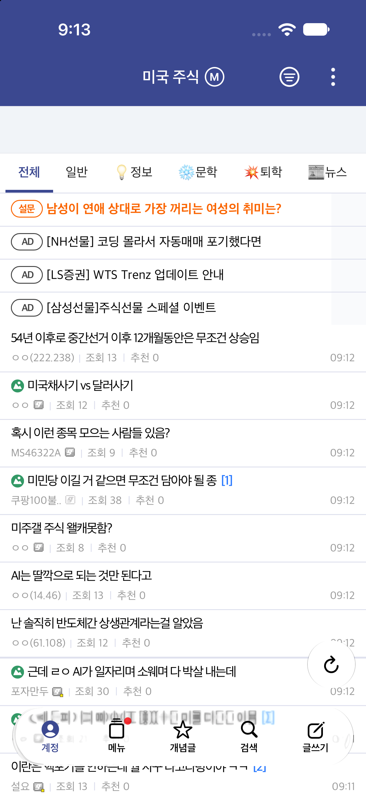

- **말머리 탭**: 글 목록 위에 말머리가 둥근 탭으로 한 줄에 놓입니다. 좌우로 넘겨 고르고, 지금 보고 있는 말머리는 테마 색으로 표시됩니다.
- **댓글 수**: 제목 바로 뒤에 파란 `[댓글수]`로 보여 줍니다.
- **컨트롤바**: 계정 · 메뉴 · 개념글 · 검색 · 글쓰기를 한곳에 모은 버튼 막대입니다. 순서는 설정에서 바꿀 수 있습니다.
- **스크롤하면 숨기기**: 스크롤하는 동안 컨트롤바가 화면 밖으로 들어갔다가, 멈추면 바로 다시 나옵니다.
- **개념글 뒤로가기**: 개념글 2페이지 이상에서 뒤로 가면 전체글이 아니라 바로 앞 페이지로 갑니다.

### 기기별 화면

컨트롤바는 기기와 화면 방향에 맞춰 **하단 가로 막대** 또는 **오른쪽 세로 막대**로 놓입니다. 가로로 쓸 때 · 세로로 쓸 때 어느 쪽으로 둘지 설정에서 따로 고를 수 있습니다.

| 아이패드 (세로) | 아이패드 (가로) |
|:---:|:---:|
| 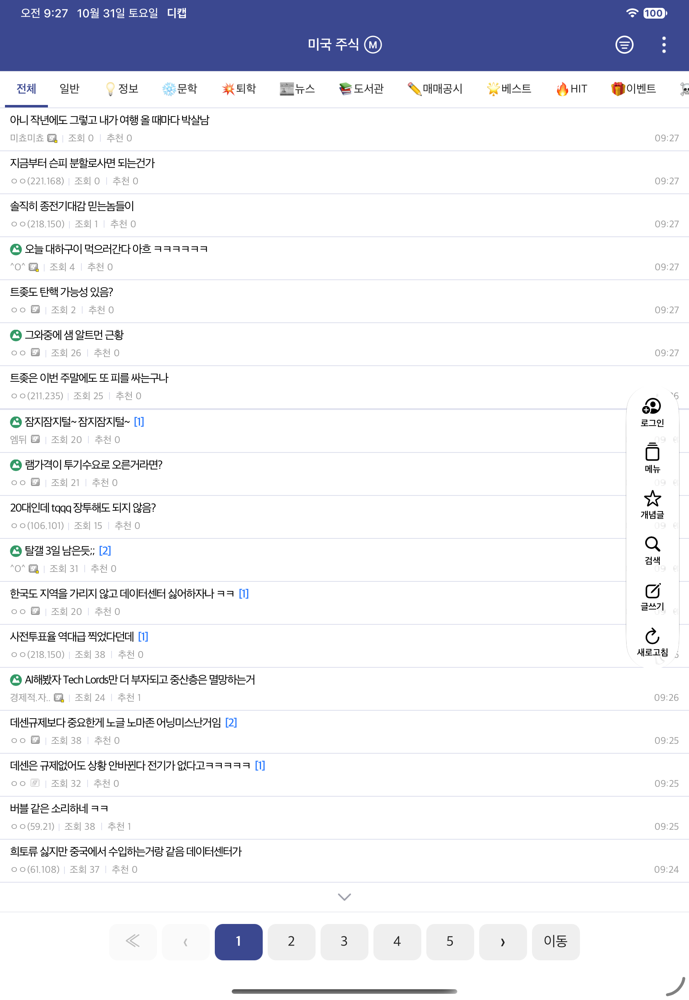 | 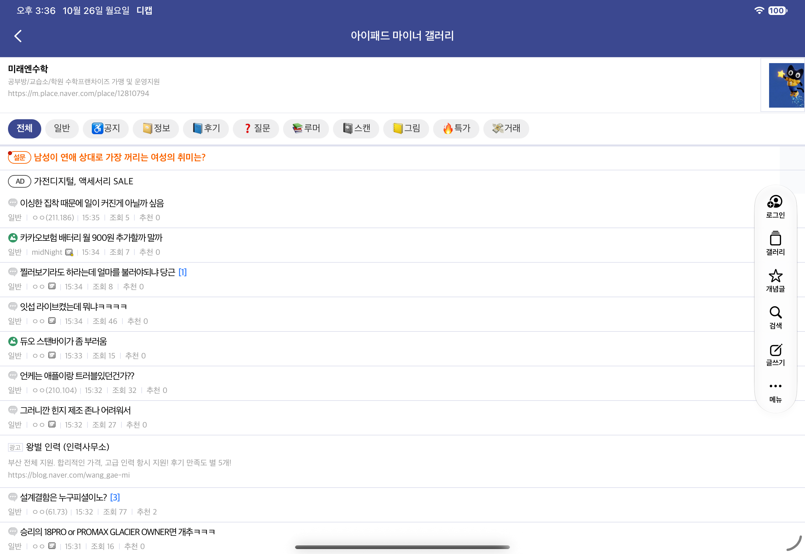 |

| 아이폰 듀오 (접은 화면) | 듀오 (펼친 화면 · 가로) | 듀오 (펼친 화면 · 세로) |
|:---:|:---:|:---:|
| 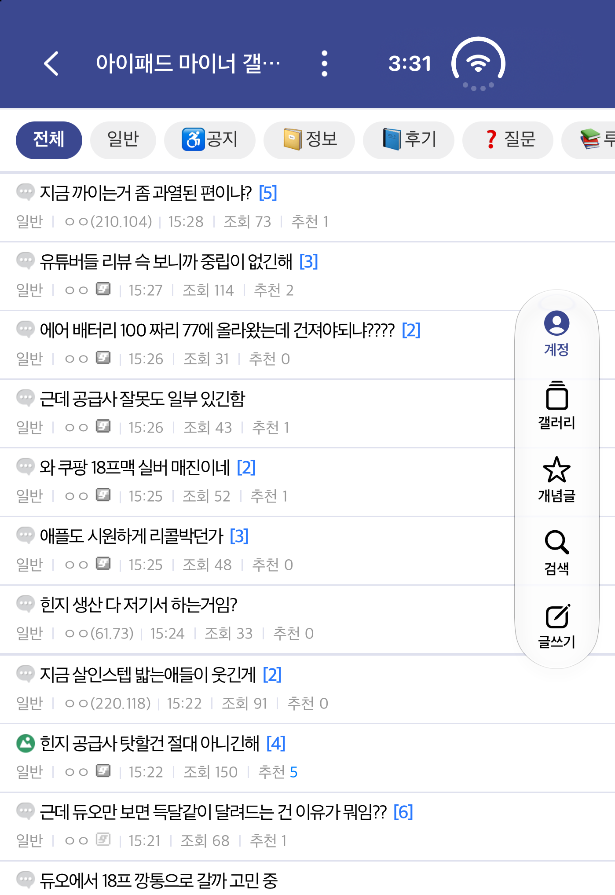 | 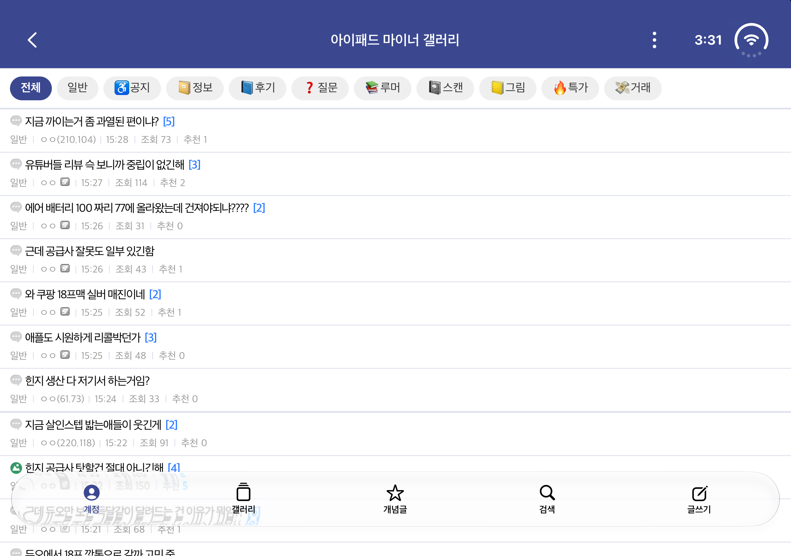 | 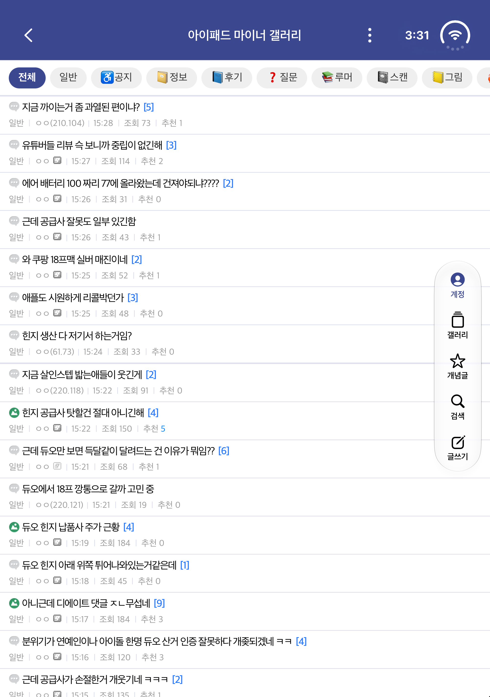 |

- **아이폰 듀오 대응**: 시계 · 상태 표시를 화면 옆 세로 줄이 아닌 위쪽에 두고, 앱 화면을 끝까지 씁니다.

---

## 2. 글 읽기 · 댓글

  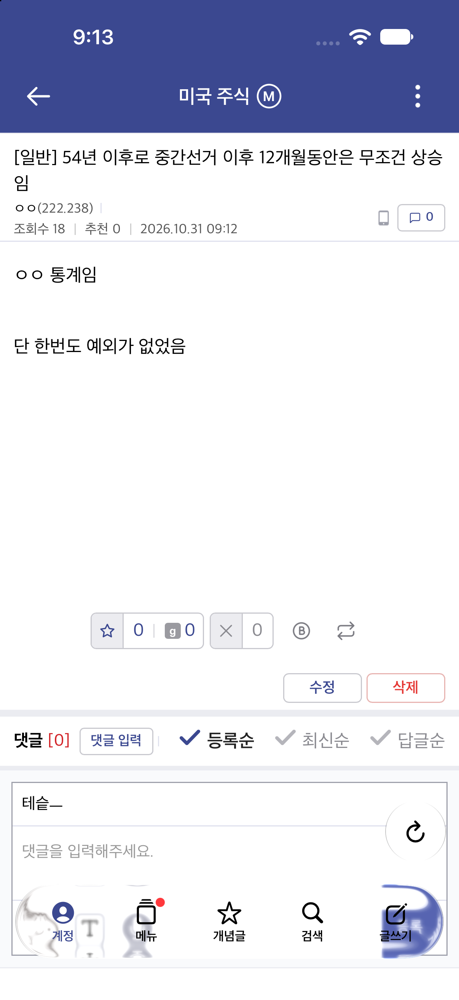

- **추천 · 비추 칸**: 개추와 비추를 한 줄에 모았습니다. 실베추 · 펌 버튼이 비추 옆에 붙어 있고, 본인 글이면 수정 · 삭제 버튼이 아래 줄 오른쪽에 나옵니다.
- **댓글 정렬**: 등록순 · 최신순 · 답글순을 댓글 머리글에서 바로 고릅니다.
- **댓글 입력**: 댓글창을 누르면 키보드가 올라오고, 입력창이 키보드 바로 위에 고정됩니다.
- **답글**: 댓글을 누르면 답글 칸이 열립니다.
- **새로고침**: 글을 다시 불러온 뒤 댓글 쪽으로 이동합니다. 다른 기기에서 쓴 댓글도 보입니다.
- **사진 보기**: 글 속 사진을 탭하면 전체 화면으로 보고, 확대 · 넘기기 · 원본 저장(움짤 포함)을 할 수 있습니다.

---

## 3. 차단 · 메모

  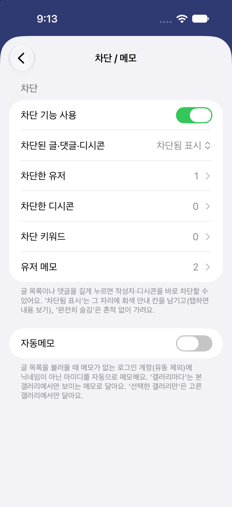

- **닉네임을 탭하거나 길게 누르면** 디시 차단 창 대신 앱의 차단 · 메모 메뉴가 뜹니다.
- **아이디 · IP · 닉네임**으로 차단할 수 있고, 직접 입력해서 추가할 수도 있습니다.
- 차단할 때 **이 갤러리에서만 / 모든 갤러리에서** 중 범위를 고릅니다.
- **키워드 차단**, **디시콘 차단**도 됩니다.
- 차단된 글 · 댓글은 **차단됨 표시**(회색 칸, 탭하면 보기) 또는 **완전히 숨김** 중에서 고릅니다.
- **유저 메모**: 아이디 · IP · 닉네임에 짧은 메모를 달면 닉네임 옆에 보여 줍니다. 메모도 갤러리별로 따로 달 수 있습니다.
- **자동메모**: 메모가 없는 로그인 계정(유동 제외)에 닉네임 대신 아이디를 자동으로 메모해 줍니다. 범위는 **모든 갤러리 / 갤러리마다 / 선택한 갤러리만**에서 고릅니다. 글 목록과 글 안의 댓글에 모두 적용됩니다.

---

## 4. 앱 내 알림

| 알림 배너 | 알림 탭 |
|:---:|:---:|
| 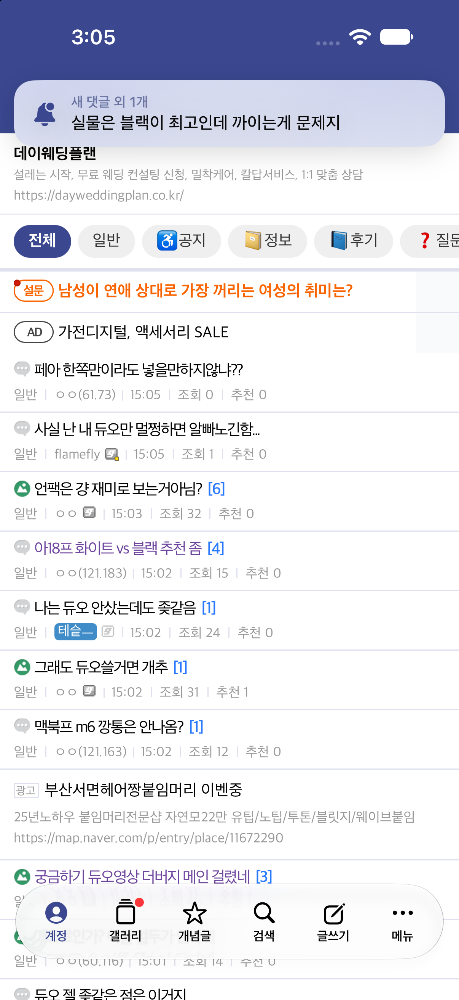 | 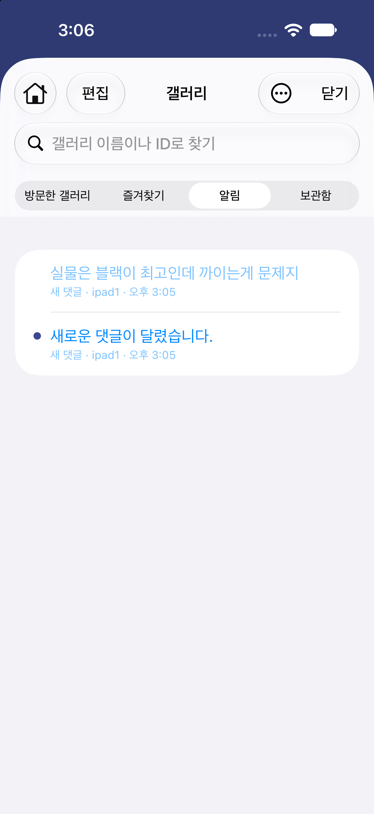 |

- 내 글 · 댓글에 새 댓글이 달리면 앱 사용 중에 화면 위에 **배너**로 잠깐 보여 줍니다. 누르면 그 글로 갑니다.
- 받은 알림은 **갤러리 → 알림** 탭에 쌓이고, 읽지 않은 알림이 있으면 컨트롤바의 갤러리 버튼에 빨간 점이 붙습니다.
- 디시 웹이 띄우는 알림 팝업은 숨기고 앱 알림으로 대신합니다.

---

## 5. 계정 저장 · 전환

  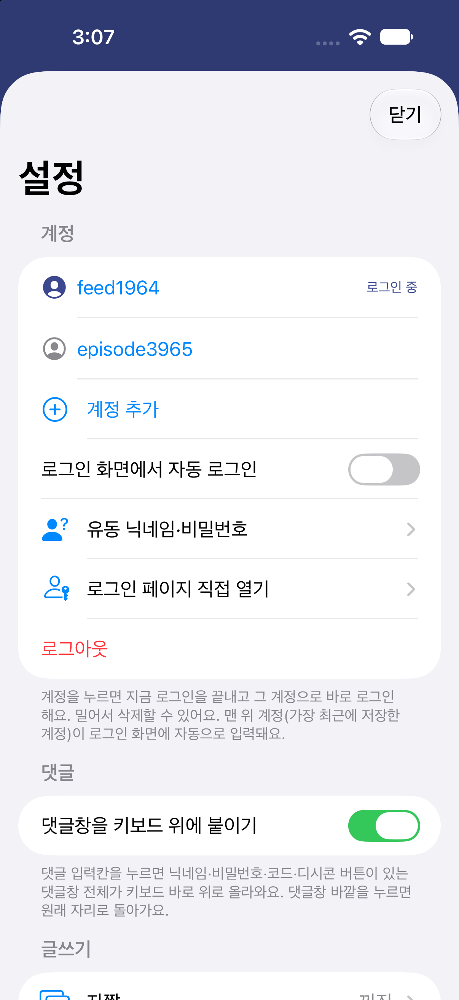

- **여러 계정 저장**: 계정 정보는 기기 키체인에 암호화해 보관합니다.
- **탭 한 번으로 전환**: 계정을 누르면 지금 로그인을 끝내고 그 계정으로 바로 로그인합니다.
- **자동 로그인**: 로그인 화면에서 저장한 계정을 자동으로 입력할 수 있습니다.
- **유동 닉네임 · 비밀번호**: 비로그인으로 댓글을 쓸 때 닉네임과 비밀번호를 자동으로 채웁니다.
- 로그인 후 뜨는 **비밀번호 변경 안내는 자동으로 건너뜁니다.**

---

## 6. 임시저장

  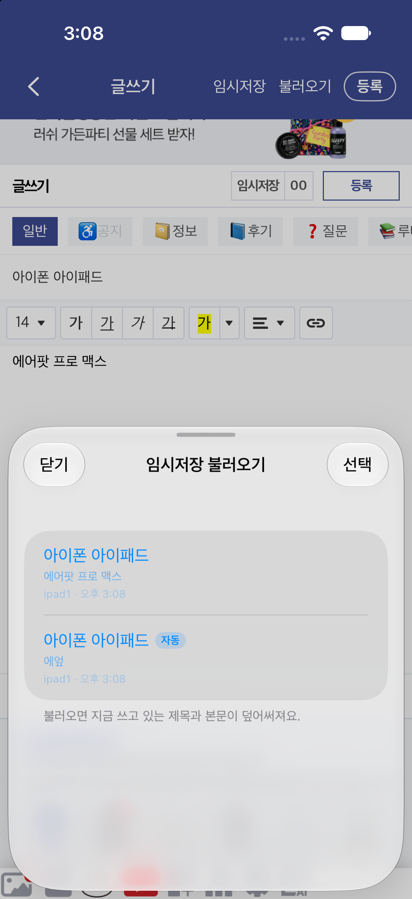

- 글쓰기 화면 상단바에 **임시저장 · 불러오기 · 등록** 버튼이 있습니다.
- 쓰는 중인 글은 **자동으로 임시저장**되고, 직접 저장한 글과 함께 목록에서 골라 이어 쓸 수 있습니다. 자동 저장된 글에는 `자동` 표시가 붙습니다.

---

## 7. 한손 모드

  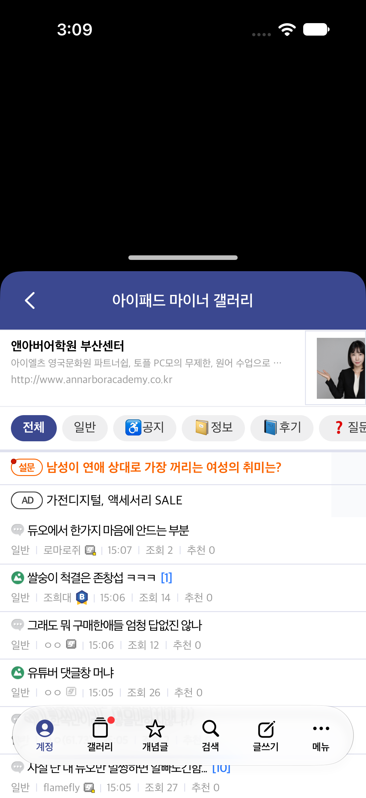

- 화면 위쪽을 비우고 아래쪽에서만 앱을 씁니다. 큰 화면에서도 엄지가 닿는 곳에 내용이 옵니다.
- 비운 위쪽에는 **PiP(화면 속 화면) 영상**을 띄워 두고 함께 볼 수 있습니다.
- 상단바의 갤러리 이름을 **길게 눌러** 켜고, 손잡이를 **맨 위까지 끌어 잠깐 버티면** 해제됩니다. 손잡이로 높이도 조절할 수 있습니다.

---

## 8. 글 보관함

  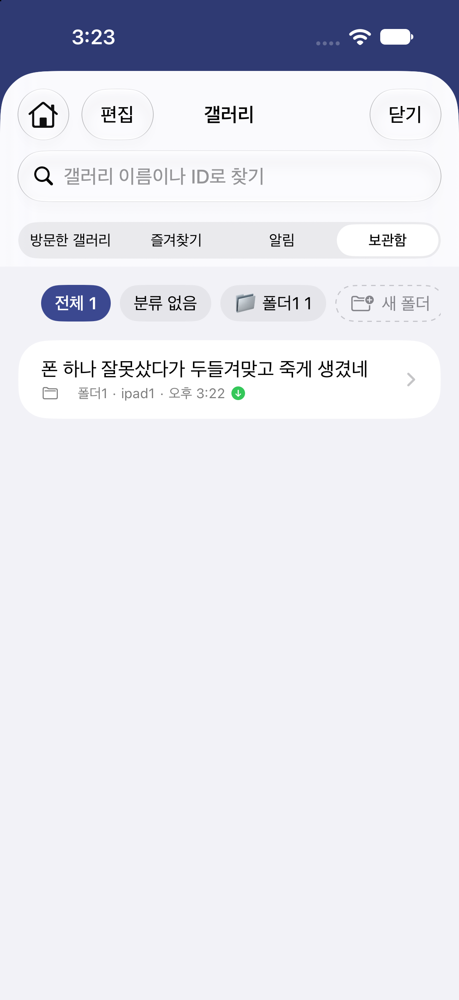

- 마음에 드는 글을 **폴더별로 보관**합니다. 저장할 때의 내용도 함께 보관해서, 원글이 지워져도 다시 볼 수 있습니다.
- **갤러리 → 보관함** 탭에서 전체 · 분류 없음 · 폴더별로 모아 봅니다.

---

## 9. 각종 설정

  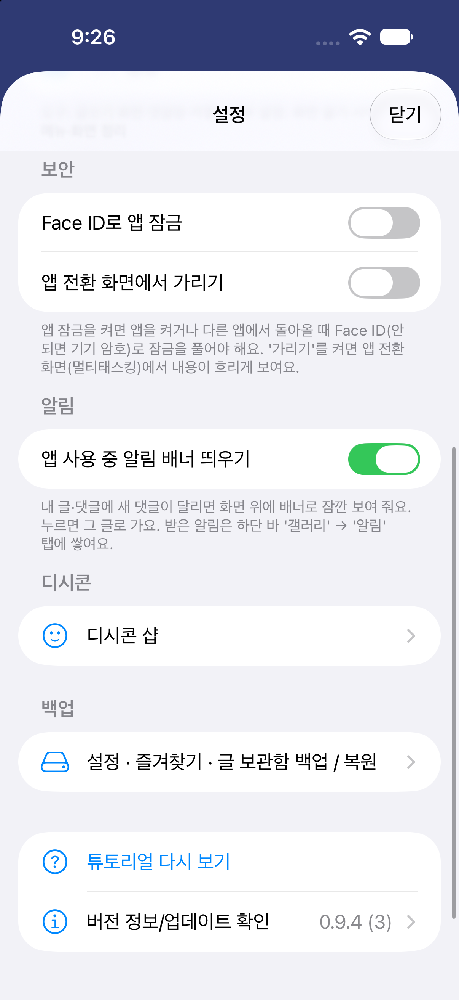

- **테마**: 상단바와 강조색을 바꿉니다. 웹페이지 속 디시 파란색도 테마 색에 맞춰집니다.
- **스와이프 뒤로가기**: 화면을 오른쪽으로 쓸어 뒤로 가고, 민감도를 조절합니다. 갤러리 목록에서 쓸면 갤러리 창을 엽니다.
- **사이트 상단 메뉴 숨기기**: 앱 상단바와 겹치는 디시 헤더를 숨깁니다.
- **홈 화면 대신 실북갤 순위 보기**
- **컨트롤바 버튼**: 버튼 순서, 가로 · 세로 배치, 스크롤할 때 숨기기, ⋮ 메뉴를 상단바로 옮기기
- **앱 아이콘 변경**
- **보안**: Face ID(또는 Touch ID)로 앱 잠금, 앱 전환 화면에서 내용 가리기
- **설정 백업 · 복원** (JSON, 비밀번호 제외)

### 그 밖의 기능

- **갤러리 내 검색**: 말머리 · 검색 범위 · 개념글만 · 최근 검색어
- **⋮ 메뉴**: 갤러리 즐겨찾기, 갤러리 공지 보기, 갤러리 관리 내역, 링크 공유, 화면 캡처, 화면 정리(요소 숨기기)
- **캡처**: 보이는 화면 / 전체 페이지 캡처
- **자짤**: 미리 등록한 사진을 글쓰기 화면에 자동으로 첨부합니다(갤러리별 설정).
