# DCAPP (디캡) 기능 소개

디캡은 디시인사이드 모바일 웹(m.dcinside.com)을 아이폰 · 아이패드 · 아이폰 듀오에서 더 편하게 보기 위해 만든 **개인용 iOS 앱**입니다.  
이 문서는 앱 내 튜토리얼 구성을 바탕으로 주요 기능을 스크린샷과 함께 소개합니다. 전체 기능 요약과 라이선스는 [README](README.md)를 참고하세요.

> ⚠️ 디시인사이드와 관계없는 **비공식** 앱입니다. 사이트 구조가 바뀌면 일부 기능이 동작하지 않을 수 있습니다.

> 📌 스크린샷의 갤러리는 앱 설명용 사진을 찍기 위해 제작자가 임의로 고른 갤러리이며, 제작자가 평소 활동하는 갤러리가 아닙니다.

## 목차

1. [컨트롤바 · 나무위키 검색](#1-컨트롤바--나무위키-검색)
2. [글 목록 · 말머리 · 필터 · 자동 이어 붙이기](#2-글-목록--말머리--필터--자동-이어-붙이기)
3. [작성자 · 갤러리 검색](#3-작성자--갤러리-검색)
4. [글 읽기 · 사진 · 댓글](#4-글-읽기--사진--댓글)
5. [차단 · 메모 · 고급 차단](#5-차단--메모--고급-차단)
6. [분할 화면 · 한손 모드 · 듀오](#6-분할-화면--한손-모드--듀오)
7. [글쓰기 · 계정 · 잠금 · 알림](#7-글쓰기--계정--잠금--알림)
8. [글 보관함 · 각종 설정 · 업데이트](#8-글-보관함--각종-설정--업데이트)

---

## 1. 컨트롤바 · 나무위키 검색

  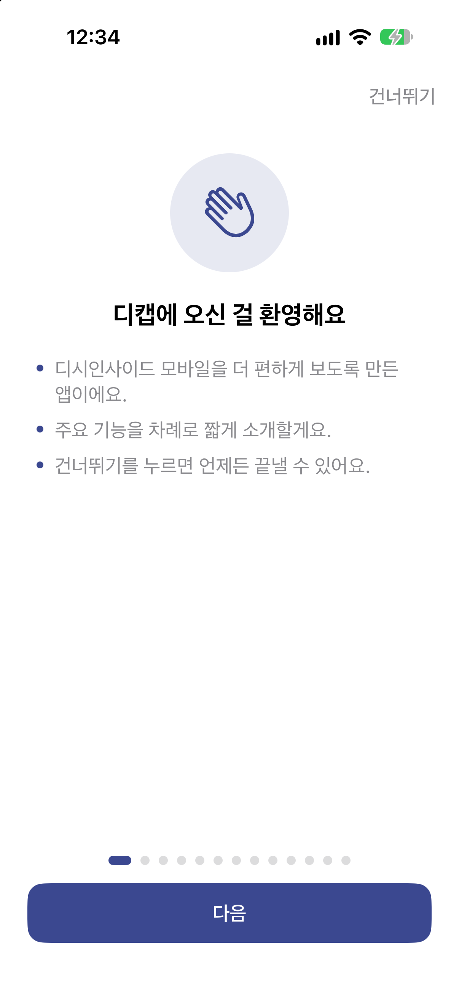

- **컨트롤바**: 계정 · 메뉴 · 개념글⇄전체글 · 검색 · 글쓰기를 한 막대에 모았습니다.
  - 설정 → 컨트롤바에서 **가로로 쓸 때(하단 바) / 세로로 쓸 때(오른쪽 막대)** 배치를 따로 고릅니다.
  - 가로 바(비분할)에서 글을 볼 때는 개념글 버튼이 **댓글작성** 버튼으로 바뀝니다.
  - 막대를 옆으로 밀면 둘째 칸(**나무위키 · 차단·메모 · 보관함/즐겨찾기 · 링크 공유**)이 나오며, 버튼 순서 · 접기 · 스크롤 시 자동 숨김을 설정할 수 있습니다.
- **나무위키 검색**: 둘째 칸의 **나무위키**를 누르면 검색 창이 열립니다.
  - 검색어를 비워 두면 **실시간 검색어**가 순위대로 나오며, 항목을 **왼쪽으로 밀면** 실검 사유를 바로 볼 수 있습니다.
  - 입력 중에는 **연관 검색어**가 뜨며, 앱 안의 창에서 바로 열고 닫으면 보던 디시 화면이 그대로 남습니다.

---

## 2. 글 목록 · 말머리 · 필터 · 자동 이어 붙이기

  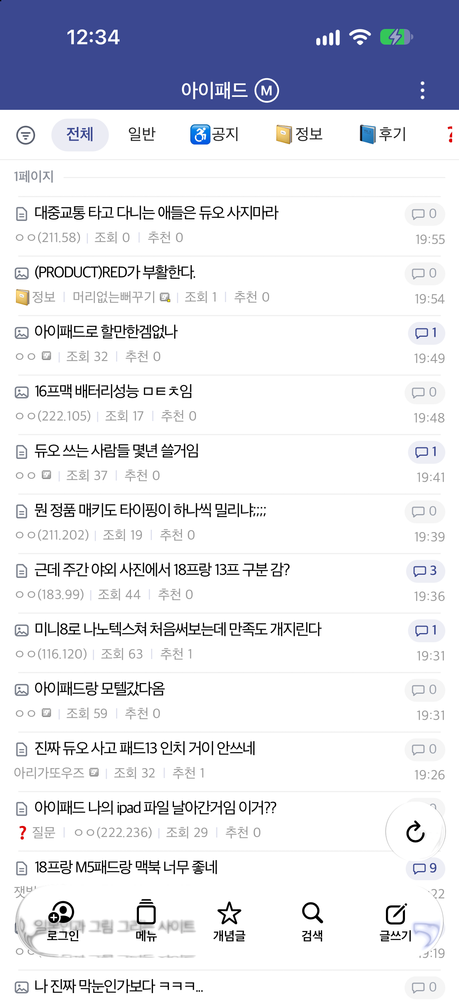

- **상단 고정 말머리 줄**: 필터 버튼과 `전체` 탭이 왼쪽에 고정되고, 나머지 말머리는 가로로 넘겨 고릅니다.
- **게시물 필터**: 말머리 줄 왼쪽 깔때기(말머리가 없는 갤러리는 상단바 우측)에서 **특정 말머리 · 읽은 글 · 추천/댓글/조회수** 조건으로 걸러 봅니다.
- **깔끔한 행 구성**: 글 종류 아이콘, 오른쪽 댓글 캡슐 배지(눌러서 댓글로 바로 이동)와 작성시간 정렬, 부드러운 여백 구분선, `N페이지` 구분선 표시.
- **자동 이어 붙이기**: 목록 맨 아래로 스크롤하면 다음 페이지가 자동으로 이어지며, 상단에 지나온 페이지 번호가 고정 표시됩니다.
- **글 롱프레스 메뉴**: 글을 꾹 누르면 차단 · 메모 · 갤로그 · 작성글 찾기 메뉴가 바로 열립니다.

---

## 3. 작성자 · 갤러리 검색

- **2탭 검색 시트**: 갤러리 안에서 검색을 누르면 **갤러리 내 글 검색**(말머리 · 검색 범위 · 개념글만)과 **통합검색**을 상단 탭으로 바로 오갑니다.
- **실시간 갤러리 찾기**: 검색어 입력 중에도 정식 · 마이너 · 미니 · 인물 갤러리 검색 결과가 바로 뜹니다.
- **식별코드 · IP로 작성글 찾기**: 검색 시트나 닉네임/글 꾹 누르기 메뉴에서 해당 작성자(유동은 IP 앞 두 칸 기준)의 글만 모아서 볼 수 있습니다. 창을 닫아도 뒤에서 계속 수집합니다.

---

## 4. 글 읽기 · 사진 · 댓글

  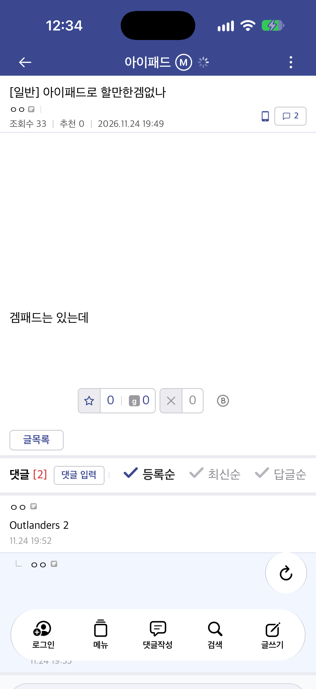

- **추천 · 비추 칸**: 개추와 비추를 한 줄에 모으고 실베추 · 펌 · 수정/삭제를 정리했습니다. 비로그인 추천 코드 입력과 재시도도 지원합니다.
- **댓글 정렬 · 입력**: 등록순 · 최신순 · 답글순으로 정렬하고, 세로 컨트롤바 사용 시 댓글 입력창이 화면 아래에 고정됩니다.
- **사진 보기**: 글 속 사진을 탭하면 전체 화면으로 보고, 핀치·더블탭 확대, 좌우 넘기기, 원본 저장(움짤 포함) 및 **전체 일괄저장**, 본문 이미지 차단이 가능합니다.

---

## 5. 차단 · 메모 · 고급 차단

| 차단·메모 설정 | 차단 목록 |
|:---:|:---:|
| 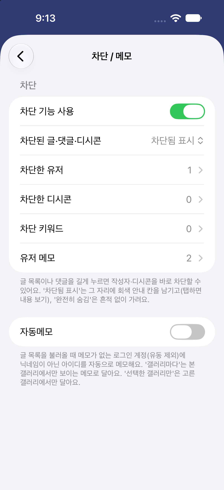 | 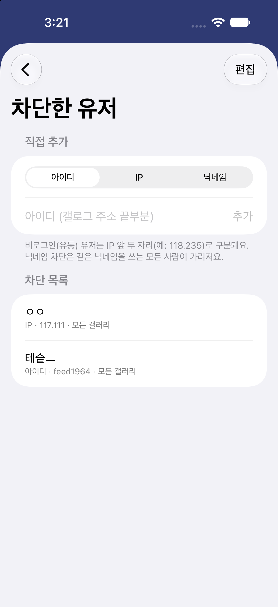 |

- **작성자 차단 · 메모**: 닉네임·글을 탭하거나 길게 눌러 **아이디 · IP · 닉네임** 차단 및 주황색 메모를 남깁니다(이 갤러리만 / 모든 갤러리 선택).
- **자동메모**: 메모가 없는 로그인 계정에 아이디를 자동으로 표시합니다.
- **키워드 · 고급 차단**: 일반 키워드 외에 작성자 + 단어 복합 조건, **특수문자 · 공백 끼워넣기 우회 막기**를 지원합니다.
- **디시콘 · 이미지 차단 & 요소 숨기기**: 디시콘을 길게 눌러 **하나만** 또는 **패키지 전체**를 차단합니다(움직이는 디시콘 포함). 본문 이미지 차단과 화면 요소 직접 선택 숨기기를 지원하며, 차단된 글은 **접기** 또는 **완전 숨김** 중 고릅니다.

---

## 6. 분할 화면 · 한손 모드 · 듀오

| 아이패드 (세로) | 아이패드 (가로) |
|:---:|:---:|
| 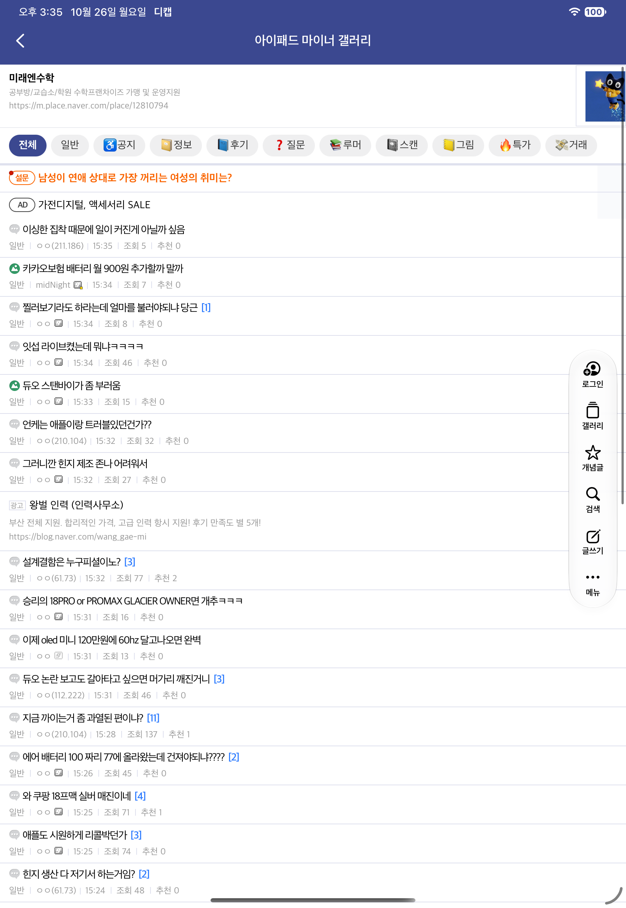 | 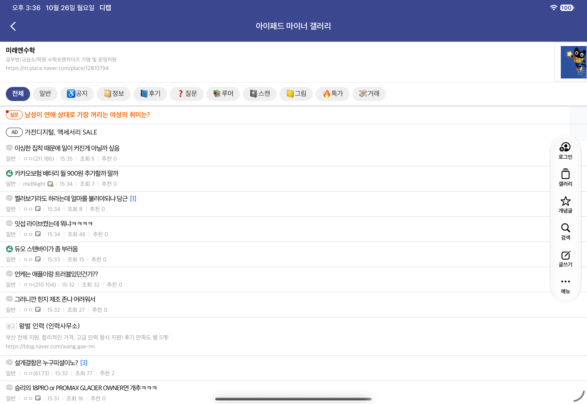 |

| 아이폰 듀오 (접은 화면) | 듀오 (펼친 화면 · 가로) | 듀오 (펼친 화면 · 세로) |
|:---:|:---:|:---:|
| 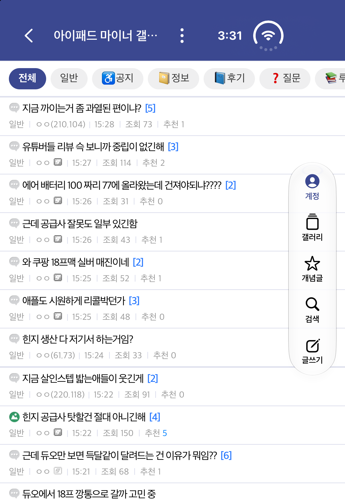 | 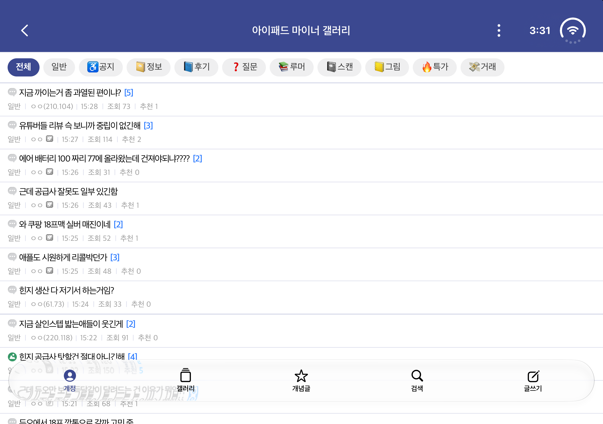 | 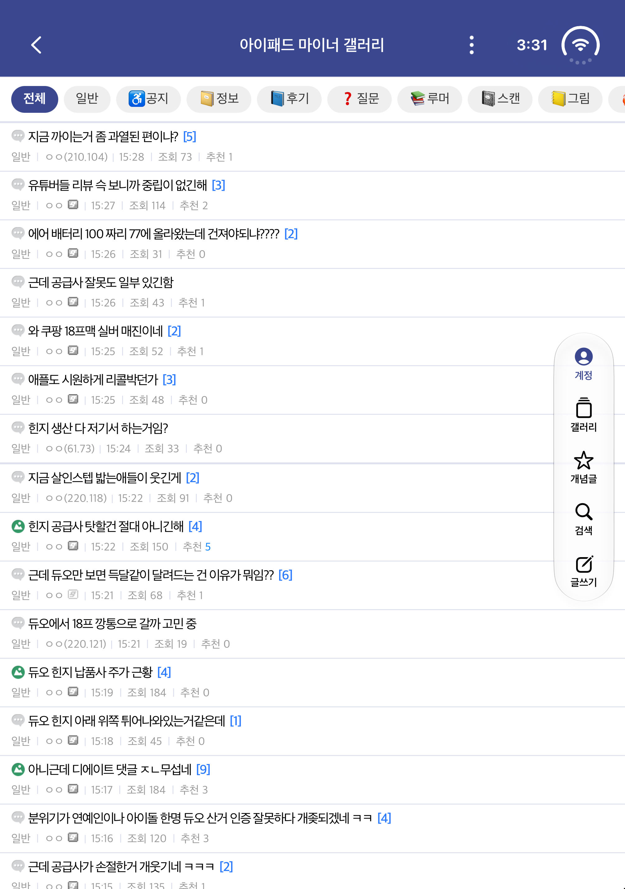 |

| 한손 모드 |
|:---:|
| 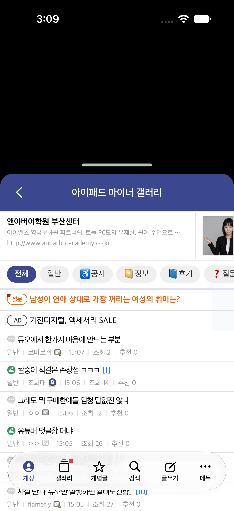 |

- **분할 화면**: 아이패드·듀오 펼친 가로 화면에서는 왼쪽 목록 · 오른쪽 글을 나란히 보며, 접거나 돌려도 보던 글이 새로고침 없이 그대로 이어집니다.
- **듀오 안전 영역 대응**: 세로 막대 시 시계·배터리 영역과 겹치지 않게 여백을 두고, 가로 막대 시에는 화면 끝까지 넓게 쓸 수 있습니다.
- **한손 모드**: 상단바 갤러리 이름을 0.5초 길게 눌러 켜고, 핸들을 맨 위로 끌어 잠깐 버티면 해제됩니다.

---

## 7. 글쓰기 · 계정 · 잠금 · 알림

| 계정 저장·전환 | 임시저장 | 알림 배너 | 알림 탭 |
|:---:|:---:|:---:|:---:|
| 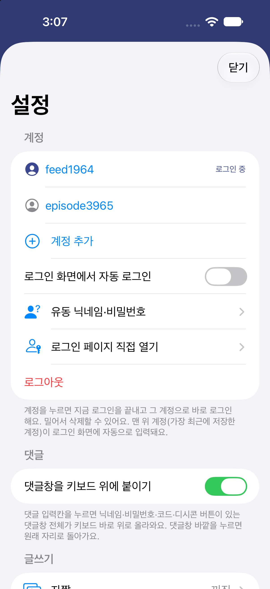 | 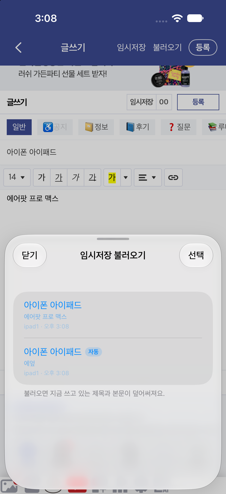 | 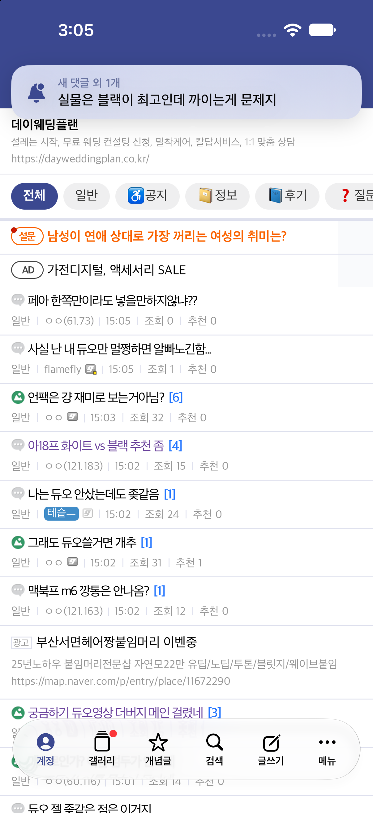 | 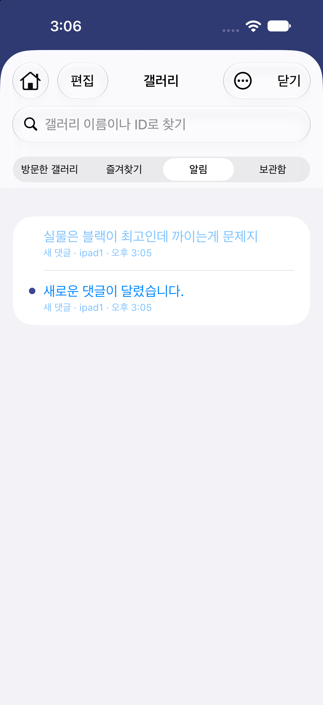 |

- **글쓰기**: 사진 포함 자동 임시저장, 갤러리별 자짤 자동 첨부, **금지어 등록 실패 시 첫 번째 금지어 위치 자동 선택**을 지원합니다.
- **계정 · 잠금**: 다중 계정 키체인 저장 및 원탭 전환, 유동 닉네임·비밀번호 자동 입력, Face ID / Touch ID 및 기기 암호 잠금 해제, 가림막 꾸미기를 지원합니다.
- **앱 내 알림**: 새 댓글 알림 배너 및 메뉴 → 알림 탭에서 확인합니다.

---

## 8. 글 보관함 · 각종 설정 · 업데이트

| 글 보관함 | 설정 |
|:---:|:---:|
| 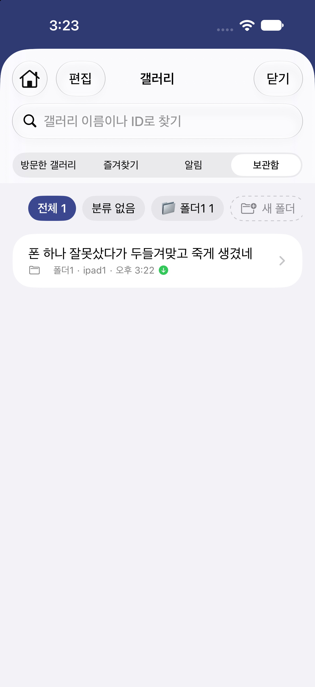 | 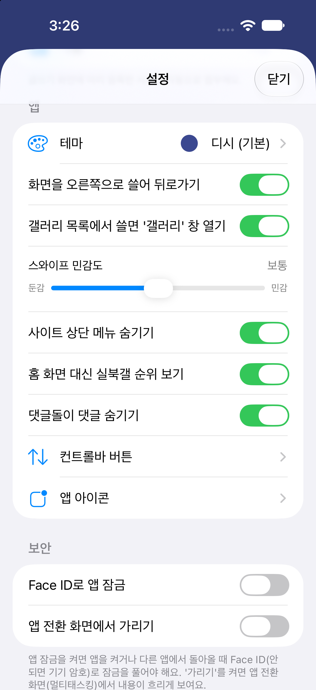 |

- **글 보관함**: 글을 폴더별로 오프라인 저장해 원글이 지워져도 다시 봅니다.
- **설정 · 프로필 · 백업**: 테마 색, 스와이프 뒤로가기 민감도, 앱 아이콘 변경, 다중 프로필 분리, 설정 JSON 백업·복원을 지원합니다.
- **업데이트 · 튜토리얼**: GitHub / GitLab 최신 릴리즈 자동 확인 및 Feather · SideStore · LiveContainer 바로 설치(`source.json` 지원), 설정 → **튜토리얼 다시 보기**를 제공합니다.
